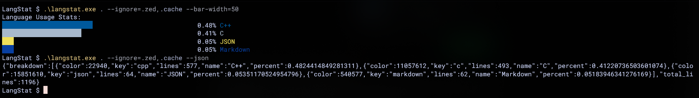

# LangStat
---
A fast and simple CLI utility for analyzing programming language statistics in source trees.

## Features
---
 * Recursive traversal by default
 * Terminal-based visualization
 * JSON output support
 * Automatic language detection for common source file types

## Build
---
All required dependencies are bundled inside the repository.

```sh
$ git clone https://github.com/vxppy/langstat.git
$ cd langstat
$ make
```

## Usage
---
Analyze a source tree:

```sh
$ langstat path/to/folder
```

Ignore files or directories using patterns:

```sh
$ langstat path/to/folder --ignore=pattern
```

Output results as JSON:

```sh
$ langstat path/to/folder --json
```

Show the full help menu:

```sh
$ langstat --help
```

## Example Output



## Dependencies
---
Third-party libraries are vendored inside `/third_party`, so no additional installation is required.
Their licenses are includes in their respective folders

 * [nlohmann/json](https://github.com/nlohmann/json)
 * [p-ranav/argparse](https://github.com/p-ranav/argparse)

## License
---
See `LICENSE` for more information.
